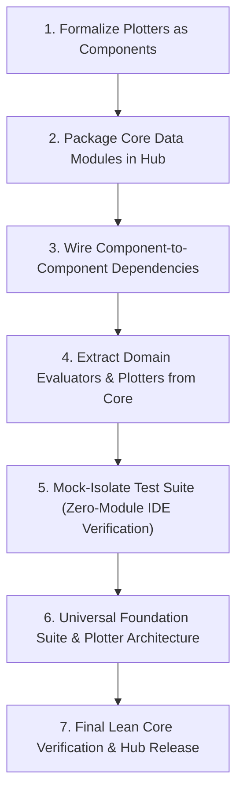

# Theta-IDE Modularization & Zero-Bloat Architecture Roadmap

## 1. Executive Summary & The North Star

**The Core Goal:**
Transform Theta-IDE into a **pure execution engine, orchestrator, and IDE shell** that contains **zero domain-specific code or pre-baked algorithm/model/evaluator/plotter bloat**. 

Everything that is not core infrastructure belongs in **Theta-Hub** as decoupled, independently packageable, and installable components:
$$\text{Theta-IDE Core} = \text{Runner Engines (SB3/D3RLPy/Lightning)} + \text{Protocols/Registries} + \text{Config Engine (Hydra)} + \text{GUI}$$
$$\text{Theta-Hub Components} = \text{Algorithms} \cup \text{Models} \cup \text{Environments} \cup \text{Data Modules} \cup \text{Evaluators} \cup \text{Plotters} \cup \text{Suites}$$

---

## 2. Current State vs. What Remains

| Component Type | Registry & Runtime | GUI / Hub Support | Migrated Out of Core |
|---|---|---|---|
| **Algorithms** | Implemented (`src/usr/algorithms/`, `@register_algorithm`) | Implemented (ConfigViewer, Scaffolder, Hub tabs) | Decoupled (handled via SB3/D3RLPy runners & plugins) |
| **Models** | Implemented (`src/app/core/model_registry.py`, `@register_model`) | Implemented (Model cards, Scaffolder, Hub) | Packaged in `dl_basics_suite` & Hub |
| **Environments** | Implemented (`VectorizedBaseEnv`, `in/envs/`) | Implemented (Env cards, Scaffolder, Hub) | Modularized in Hub packages |
| **Data Modules** | Implemented (`src/usr/data/`, `@register_datamodule`) | Implemented (Tier 1 configs, Hub manifests) | Packaged in Hub (`atari-image-data`, `rl-replay-buffer`, etc.) |
| **Evaluators** | Implemented (`src/app/core/eval_registry.py`, `@register_evaluator`) | Implemented (Scaffolder, Hub tabs) | Packaged in Hub (`pyrenees-evaluator`, `early-prediction`, `reward-shaping`) |
| **Checkpoint Hooks** | Implemented (Declarative `checkpoint:` in `lightning_builder.py`) | Implemented (ConfigViewer Checkpoint Box) | N/A (Declarative config) |
| **Plotters** | Implemented (`src/app/core/plotter_registry.py`, `@register_plotter`) | Implemented (Scaffolder, Exporter, Actions) | Domain plotters packaged in suites (`mimic-clinical-suite`, `pyrenees-benchmark-suite`) |

---

## 3. Implementation Status

### Phase 1: Plotters as First-Class Modular Components
- [x] **Plotter Protocol & Registry (`src/app/core/plotter_registry.py`)**:
  - Implemented `@register_plotter(*names)` decorator to formalize `BasePlotter` contracts.
  - Implemented `auto_discover_plotters()` scanning `plot/` root and package subdirectories.
  - Updated `plot/manager.py` to route through the central Plotter Registry.
- [x] **Plotter Component Scaffolding**:
  - Added `plotter` to `src/app/services/plugin_scaffolder.py` and `frontend/scaffold_dialog.py`.
  - Generates `plot/my_plotter/my_plotter_plotter.py`, default config `in/config/plot/my_plotter.yaml`, and `.theta_component.json`.
- [x] **Export & Uninstall Hooks for Plotters**:
  - Updated `frontend/component_actions.py` and `src/app/services/component_exporter.py` to support exporting, deleting, and editing plotter components.

---

### Phase 2: Decouple & Package Data Modules for Theta-Hub
- [x] **Package Core Data Loaders as Hub Components**:
  - `atari-image-data`: Image frame stacking, grayscale downscaling, and observation transformations (`src/usr/data/atari_image_data/`).
  - `rl-replay-buffer`: Transition reader, offline chunking, and memory-mapped sampling (`src/usr/data/rl_replay_buffer/`).
  - `tabular-npz-data`: Standard regression/classification array loaders (`src/usr/data/tabular_npz_data/`).
  - `mimic-sepsis-data`: Time-series ICU windowing, cohort splitting, and vital sign imputation (`src/usr/data/mimic_sepsis_data/`).
- [x] **Component Dependency Linking**:
  - Wired `dependencies.components: ["atari-image-data"]` into `atari-env`.
  - Added and verified automated recursive installation test (`tests/test_hub_dependencies.py`).
- [x] **Default Data Module Configurations (`in/config/data/`)**:
  - Provided Tier 1 default configs (`atari_image_data.yaml`, `rl_replay_buffer.yaml`, `tabular_npz_data.yaml`, `mimic_sepsis_data.yaml`).

---

### Phase 3: Decouple & Package Evaluators for Theta-Hub
- [x] **Extract Domain Evaluators into Hub Packages**:
  - `pyrenees-evaluator`: Modular package with manifest (`src/usr/eval/pyrenees_evaluator/`) and Tier 1 config (`in/config/eval/pyrenees_evaluator.yaml`).
  - `mimic-early-prediction`: Packaged with `.theta_component.json` and Tier 1 config (`in/config/eval/early_prediction.yaml`).
  - `reward-shaping`: Packaged potential-based reward shaping hooks (`src/usr/eval/reward_shaping/`) with `.theta_component.json` and Tier 1 config (`in/config/eval/reward_shaping.yaml`).
- [x] **Leave `src/usr/eval/` Lean**:
  - Evaluators self-register via `@register_evaluator` into `src/app/core/eval_registry.py`.
  - Preserved backward-compatibility shims for legacy imports.

---

### Phase 4: Purge Hardcoded Domain Bloat from Theta-IDE Core
- [x] **Extract Hardcoded Plotters into Packages**:
  - Moved clinical and early-prediction plotters into `plot/mimic_clinical_suite/` with `.theta_component.json`.
  - Moved Pyrenees and blend authority visualizers into `plot/pyrenees_benchmark_suite/` with `.theta_component.json`.
  - Core IDE root retains only abstract `BasePlotter` (`plot/base.py`), orchestrator (`plot/manager.py`), and foundational diagnostic plotters (`convergence.py`, `losses.py`, `reports.py`).
- [x] **Extract Domain Rules & Grammars**:
  - Ensured environment component exporter and installer package and extract `in/rules/<env>/` together with their respective environments.

---

### Phase 5: Test Suite Decoupling & Mocking (Zero Pre-Installed Modules)
- [x] **Audit Tests for Implicit In-Repo Component Assumptions**:
  - Evaluated all tests to use in-memory test mocks (`MockModel`, `MockAlgorithm`, `MockDataModule`, `MockEnv`) registered via fixtures.
  - Added dedicated regression test suites (`tests/test_plotter_registry.py`, `tests/test_hub_dependencies.py`).
  - Added resilient fallback and skip decorators for uninstalled components across the test suite.

---

### Phase 6: Universal Foundation Suite & Plotter Subtype Architecture
- [x] **Universal Data Loaders in `basic_suite`**:
  - Bundled generalized `image-data`, `replay-buffer`, and `tabular-data` directly into `basic_suite`.
  - Installing `basic_suite` equips a fresh workspace with standard algorithms, models, environments, and data modules.
- [x] **Plotter Configuration Hierarchy & Subtype Architecture**:
  - Established `in/config/plot/` for default plotter profiles (`convergence.yaml`, `losses.yaml`, `reports.yaml`).
  - Formalized the 5 plotter subtypes: Metric Series, Distribution, Manifold/State-Space, Domain Verification/Alignment, and Executive Reports.
  - Packaged default configs for domain plotters into `mimic-clinical-suite` and `pyrenees-benchmark-suite`.
  - Fixed `HubInstaller` file routing so both code files and `in/config/plot/` YAMLs deploy and clean up atomically.
- [x] **Architectural Contracts**:
  - **Evaluators vs Checkpoints**: Evaluators are domain metric providers (`BaseEvalProtocol`); Checkpoints are declarative persistence policies (`checkpoint.monitor`) consuming those metrics.
  - **Reward Shapers vs DataModules**: Reward shapers are the feedback counterpart to state data modules, operating as Environment Reward Wrappers (online) or Pipeline Transition Transforms (offline).

---

## 4. Execution Order Completed

