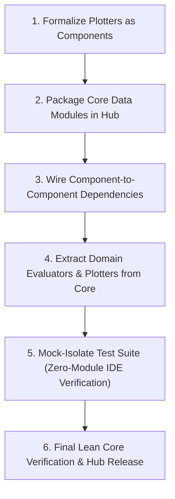

# Theta-IDE Modularization & Zero-Bloat Architecture Roadmap

## 1. Executive Summary & The North Star

**The Core Goal:**
Transform Theta-IDE into a **pure execution engine, orchestrator, and IDE shell** that contains **zero domain-specific code or pre-baked algorithm/model/evaluator/plotter bloat**. 

Everything that is not core infrastructure belongs in **Theta-Hub** as decoupled, independently packageable, and installable components:
$$\text{Theta-IDE Core} = \text{Runner Engines (SB3/D3RLPy/Lightning)} + \text{Protocols/Registries} + \text{Config Engine (Hydra)} + \text{GUI}$$
$$\text{Theta-Hub Components} = \text{Algorithms} \cup \text{Models} \cup \text{Environments} \cup \text{Data Modules} \cup \text{Evaluators} \cup \text{Plotters} \cup \text{Suites}$$

---

## 2. Current State vs. What Remains

| Component Type | Registry & Runtime | GUI / Hub Support | Migrated Out of Core |
|---|---|---|---|
| **Algorithms** | Implemented (`src/usr/algorithms/`, `@register_algorithm`) | Implemented (ConfigViewer, Scaffolder, Hub tabs) | In Progress (handled via SB3/D3RLPy runners & plugins) |
| **Models** | Implemented (`src/app/core/model_registry.py`, `@register_model`) | Implemented (Model cards, Scaffolder, Hub) | In Progress (suites packaged) |
| **Environments** | Implemented (`VectorizedBaseEnv`, `in/envs/`) | Implemented (Env cards, Scaffolder, Hub) | In Progress (Atari/Control suites) |
| **Data Modules** | Implemented (`src/usr/data/`, `@register_datamodule`) | Implemented (Group `_base.yaml` & Exp cards) | Not Yet in Hub (need packaging) |
| **Evaluators** | Implemented (`src/app/core/eval_registry.py`, `@register_evaluator`) | Implemented (Scaffolder, Hub tabs) | Lingering in Core (`src/usr/eval/`) |
| **Checkpoint Hooks** | Implemented (Declarative `checkpoint:` in `lightning_builder.py`) | Implemented (ConfigViewer Checkpoint Box) | N/A (Declarative config) |
| **Plotters** | Legacy in `plot/` root (`BasePlotter`) | Basic Hub Target added | Hardcoded in IDE root (`plot/`) |

---

## 3. Detailed Work Left to Do

### Phase 1: Plotters as First-Class Modular Components
Currently, plotters sit directly in `plot/*.py` as loose scripts with ad-hoc discovery in `plot/manager.py`.

- [ ] **Plotter Protocol & Registry (`src/app/core/plotter_registry.py`)**:
  - Implement `@register_plotter(*names)` decorator to formalize `BasePlotter` contracts.
  - Add `auto_discover_plotters()` scanning `plot/` and third-party component directories.
- [ ] **Plotter Component Scaffolding**:
  - Add `plotter` to `src/app/services/plugin_scaffolder.py` and `frontend/scaffold_dialog.py`.
  - Generates `plot/my_plotter/plotter.py`, default config `in/config/plot/my_plotter.yaml`, and `.theta_component.json`.
- [ ] **Export & Uninstall Hooks for Plotters**:
  - Ensure the GUI Components panel allows exporting, deleting, and editing plotter components just like models or algorithms.

---

### Phase 2: Decouple & Package Data Modules for Theta-Hub
We have established `src/usr/data/`, `@register_datamodule`, and 5-tier config resolution. However, no data module components have been extracted into standalone packages or published to Hub yet.

- [ ] **Package the Core Data Loaders as Hub Components**:
  - `atari-image-data`: Image frame stacking, grayscale downscaling, and color transformations.
  - `rl-replay-buffer`: Transition reader, offline chunking, and memory-mapped sampling.
  - `tabular-npz-data`: Standard regression/classification array loaders.
  - `mimic-sepsis-data`: Time-series ICU windowing, cohort splitting, and vital sign imputation.
- [ ] **Component Dependency Linking**:
  - Verify recursive installation: when `atari-env` is installed from Hub, its declared `dependencies.components: ["atari-image-data"]` automatically downloads and links the data loader into `src/usr/data/atari_image_data/`.
- [ ] **Default Data Module Configurations (`in/config/data/`)**:
  - Provide sample Tier 1 default configs (`in/config/data/<loader>.yaml`) matching the Tier 1 hierarchy of `in/config/model/` and `in/config/agent/`.

---

### Phase 3: Decouple & Package Evaluators for Theta-Hub
Domain-specific evaluators currently sit inside `src/usr/eval/` (`pyrenees_evaluator.py`, `early_prediction/`, `reward_shaping.py`).

- [ ] **Extract Domain Evaluators into Hub Packages**:
  - `pyrenees-evaluator`: Move Pyrenees trajectory and tier scoring logic into a standalone Hub component package.
  - `mimic-early-prediction`: Move septic shock predictor and evaluation logic into a standalone component.
  - `reward-shaping-evaluator`: Package potential-based reward shaping hooks.
- [ ] **Leave `src/usr/eval/` Lean**:
  - Keep only the base protocol/registry in `src/app/core/eval_registry.py` and a `.gitkeep` in `src/usr/eval/`.

---

### Phase 4: Purge Hardcoded Domain Bloat from Theta-IDE Core
To achieve the user's goal of "clearing the IDE", all domain-specific assets currently living in the repository root must be moved out:

- [ ] **Extract Hardcoded Plotters into Packages**:
  - Move `plot/clinical_alignment.py`, `plot/blend_common.py`, `plot/mimic_routing.py`, `plot/blend_authority.py`, and `plot/pyrenees_*.py` into respective domain packages on Theta-Hub (`mimic-clinical-suite`, `pyrenees-benchmark-suite`).
  - Keep only `plot/base.py` (abstract `BasePlotter`) and `plot/manager.py` in the IDE core.
- [ ] **Extract Lingering In-Repo Models**:
  - Move `src/usr/models/neural/` architectures into standalone or suite packages (`dl-basics-suite`).
- [ ] **Extract Domain Rules & Grammars**:
  - Move domain logic rules (`in/rules/mimic/`, `in/rules/pyrenees/`) into their respective environment packages rather than hardcoding them in the core repo.

---

## 5. Test Suite Decoupling & Mocking (Zero Pre-Installed Modules)

When Theta-IDE ships as an empty shell, running `pytest` should pass without requiring external or Hub components to be pre-cloned:

- [ ] **Audit Tests for Implicit In-Repo Component Assumptions**:
  - Audit all tests in `tests/` that reference specific concrete models (e.g. `cql`, `resnet`, `mimic`, `breakout`).
  - Use lightweight in-memory mocks (`MockModel`, `MockAlgorithm`, `MockDataModule`, `MockEnv`) registered via test fixtures.
  - Ensure integration tests that require real Hub packages (like `test_baselines_and_suites.py`) skip gracefully or use local temporary fixture zip archives when running in isolated test environments.

---

## 6. Execution Order

